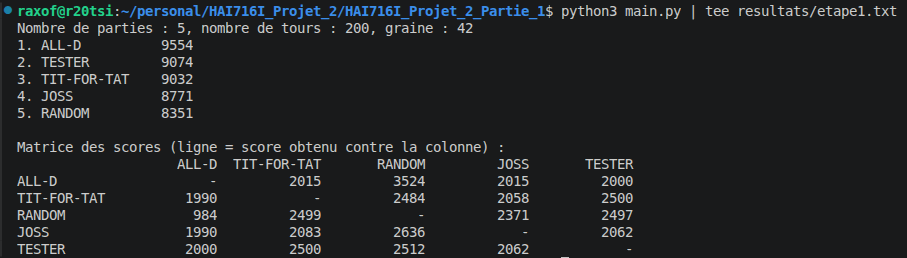
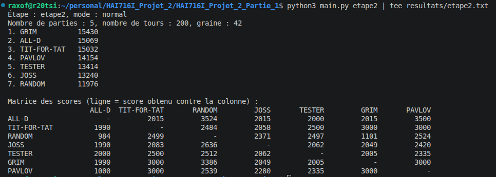
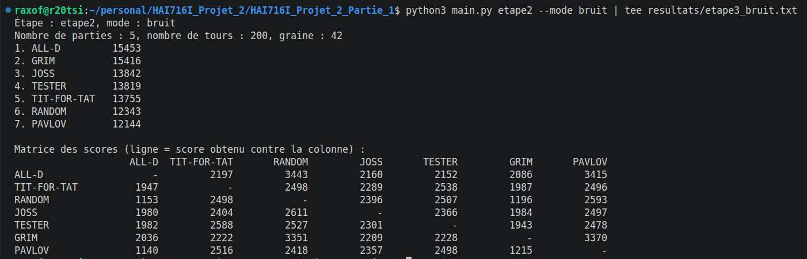
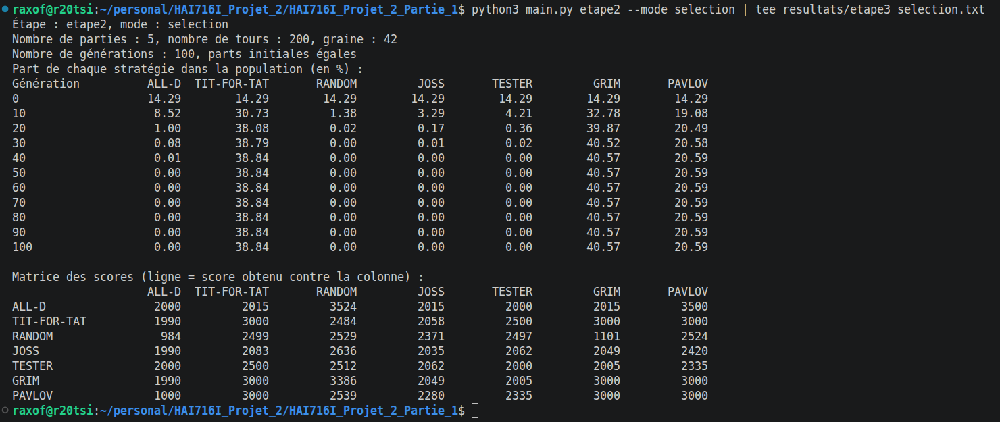

# Journal de bord : tournoi du dilemme du prisonnier itéré

## Vendredi 13/11/2026 : mise en place

- Langage : **Python**.
- Structure du projet :
  - `src/moteur.py` : matrice des gains, partie, rencontre, tournoi
  - `src/strategies.py` : les stratégies
  - `main.py` : lancement des tournois
  - `resultats/` : sorties et graphiques

## Stratégies (`src/strategies.py`)

- `Strategie` : interface qui définit les comportements de base d'une stratégie : jouer et réinitialiser (pour certaines stratégies).
- `jouer()` reçoit tout l'historique de la partie et pas seulement le dernier coup : TESTER doit savoir si l'adversaire a déjà joué D, et certaines stratégies de l'étape 2 (GRIM, TF2T) ont besoin de plus que le dernier coup.
- `AllD` : fait toujours défection, quels que soient les coups passés de l'adversaire.
- `TFT` : coopère au premier tour, puis rejoue le dernier coup de l'adversaire.
- `Random` : joue C ou D avec une chance sur deux, sans regarder l'historique. Le tirage passe par `alea`, fourni par le moteur, pour que la graine fixe tout.
- `Joss` : hérite de `TFT`. Quand TFT coopérerait, joue D avec une probabilité de 10 %.
- `Tester` : D au premier tour pour tester l'adversaire. Si l'adversaire a déjà joué D au moins une fois, passe en TIT-FOR-TAT, sinon répète le cycle C, C, D à partir du tour 2.
- Interprétation de "riposter" pour TESTER : la diapositive est ambiguë. J'ai choisi "l'adversaire a joué D au moins une fois", comme le TESTER original d'Axelrod, plutôt que "l'adversaire répond à un D de TESTER par un D au tour suivant". Les deux lectures donnent le même résultat contre ALL-D et TFT, mais pas contre RANDOM et JOSS.
- Différence avec l'original : le TESTER d'Axelrod s'excuse en jouant C au moment de passer en TFT. La version du cours ne le fait pas, donc TESTER et TFT se punissent en écho (D C D C… contre C D C D…) et ne reviennent jamais à la coopération.

## Prédiction avant le lancement de `main.py`

Qui aura le plus de points dans chaque duel :

| | ALL-D | TFT | RANDOM | JOSS | TESTER |
|---|---|---|---|---|---|
| **ALL-D** | - | ALL-D | ALL-D | ALL-D | égalité |
| **TFT** | ALL-D | - | proche | égalité | TESTER |
| **RANDOM** | ALL-D | proche | - | proche | TESTER |
| **JOSS** | ALL-D | égalité | proche | - | TESTER |
| **TESTER** | égalité | TESTER | TESTER | TESTER | - |

ALL-D gagnera des points contre RANDOM et ne perd jamais un duel, mais la plupart du temps il ne prend que 2 points par tour. TFT et JOSS sont équilibrés l'un contre l'autre : même si JOSS trahit, il en subit les conséquences ; la plupart du temps 3 points, parfois 2. Même chose pour TESTER, qui gagne plus que les autres contre RANDOM puisqu'il a plus de chances de gagner le premier tour ; sinon, il joue comme TFT. RANDOM perdra le plus de points contre ALL-D, et moins contre TESTER, TFT et JOSS.

Classement attendu :

1. ALL-D
2. JOSS
3. TESTER
4. TFT
5. RANDOM

TFT gagnera-t-il ? Non, je pense que TFT ne finira pas 1er : ALL-D remportera le tournoi grâce à ses points contre RANDOM. Il sera difficile de départager JOSS, TESTER et TFT, car les trois se comportent presque de la même façon : JOSS hérite de TFT, et TESTER joue comme TFT dès que l'adversaire a trahi.

## Étape 1 : résultats

- Protocole : 5 parties de 200 tours, graine 42, sans partie contre soi-même (raison : le sujet dit que "chaque stratégie affronte chaque autre", et un duel contre son propre double ne dit rien de la façon dont une stratégie s'en sort face aux autres, mais ce choix change le vainqueur, voir "TFT gagne-t-il ?").
- Capture d'écran : 
- Classement obtenu :
  1. ALL-D :         9554
  2. TESTER :        9074
  3. TIT-FOR-TAT :   9032
  4. JOSS :          8771
  5. RANDOM :        8351

### Comparaison avec la prédiction
- Ce qui était juste : All-d en premier et Random en dernier et l'approche du score de TFT et Tester
- Ce qui était faux : le classement de JOSS, et l'idée que son score serait proche de ceux de TFT et TESTER : il est loin derrière eux. Le problème vient de son score contre TESTER, à cause de ses trahisons occasionnelles, alors que TESTER et TFT ont obtenu ensemble le meilleur résultat parmi les duels sans RANDOM ni ALL-D. J'en déduis qu'être gourmand face à un adversaire imprévisible rapporte le plus, sinon, coopérer tout en punissant la trahison rapporte aussi.

### TFT gagne-t-il ?
- Réponse : Non, All-d gagne.
- Pourquoi le résultat diffère de 1980 :
  - **La population.** En 1980, 15 programmes, dont beaucoup ne trahissaient jamais en premier. Ici, TFT est le seul : il n'a aucun partenaire de coopération durable (écho contre JOSS et TESTER), et ne dépasse jamais 2,5 points par tour.
  - **RANDOM.** ALL-D lui prend 3524 points, environ 1000 de plus que TFT. Sans la colonne RANDOM, ALL-D finirait dernier.
  - **Pas de partie contre soi-même.** En 1980, chaque programme jouait aussi contre son double. Avec ces parties (calcul à part), TFT passe 1er : TFT contre TFT rapporte 3000, ALL-D contre ALL-D 2000.

## Étape 2

### Nouvelles stratégies :

- `Grim` : coopère tant que l'adversaire n'a jamais trahi, dès la première trahison, fait défection jusqu'à la fin de la partie. Origine : Friedman (1971), "grim trigger". Aucun pardon, l'opposé de la règle 3 d'Axelrod.
- `Pavlov` : gagne-reste, perd-change. Coopère au premier tour, si le dernier coup a rapporté 3 ou 5 points, le rejoue, sinon change de coup. Origine : Nowak et Sigmund (1993). Elle regarde son propre gain, pas le coup de l'adversaire comme TFT.
- Population de l'étape 2 : les 5 stratégies de l'étape 1, puis GRIM et PAVLOV ajoutées à la fin pour garder les mêmes graines. Même protocole : 5 parties de 200 tours, graine 42, sans partie contre soi-même.

### Prédiction avant le lancement

Qui aura le plus de points dans chaque nouveau duel :

| | ALL-D | TFT | RANDOM | JOSS | TESTER | GRIM | PAVLOV |
|---|---|---|---|---|---|---|---|
| **GRIM** | ALL-D | égalité | GRIM | proche | proche | - | égalité |
| **PAVLOV** | ALL-D | égalité | dépend du hasard | proche | proche | égalité | - |

Pourquoi : ALL-D ne gagne des points en plus contre ces deux stratégies qu'au premier tour ; ensuite, chacun marque 2 points par tour. GRIM et PAVLOV auront le score maximal l'un contre l'autre et contre TFT, qui est gentil. Il est difficile de savoir ce que les deux feront contre TESTER et JOSS, mais GRIM gagnera face à RANDOM après son premier D, alors que PAVLOV dépend de la chance face à l'imprévisibilité de RANDOM.

Classement attendu :

1. GRIM
2. TFT
3. PAVLOV
4. TESTER
5. ALL-D
6. JOSS
7. RANDOM

Qu'est-ce qui change par rapport à l'étape 1 ? Nous avons plus de stratégies gentilles, qui gagneront plus de points les unes contre les autres, ce qui va les aider à occuper le podium. ALL-D perd trop de points contre elles et descend donc dans le classement. Il est difficile de prédire où va TESTER, mais je dirais juste après les stratégies gentilles, car il utilise un mécanisme proche du leur. JOSS et RANDOM restent aux dernières places.

## Étape 2 : résultats

- Capture d'écran : 
- Classement obtenu :
  1. GRIM :          15430
  2. ALL-D :         15069
  3. TIT-FOR-TAT :   15032
  4. PAVLOV :        14154
  5. TESTER :        13414
  6. JOSS :          13240
  7. RANDOM :        11976

### Comparaison avec la prédiction
- Ce qui était juste : le classement est presque juste. GRIM est en première place, puisqu'il marque le maximum (3000) contre les stratégies gentilles et gagne aussi beaucoup contre RANDOM (3386). En dehors d'ALL-D, l'ordre des autres stratégies est exactement celui prédit.
- Ce qui était faux : la place d'ALL-D, que je voyais derrière toutes les stratégies gentilles. Il ne marque jamais moins de 2000 points contre un adversaire, et 3500 points ou plus contre PAVLOV et RANDOM, ce qui lui vaut la deuxième place. Mon erreur venait du duel contre PAVLOV : je pensais qu'ALL-D ne gagnait qu'au premier tour, mais PAVLOV alterne C et D face à lui (il change de coup après chaque 0 et chaque 2), et ALL-D l'exploite un tour sur deux.

### Comparaison avec l'étape 1
- Le vainqueur : GRIM prend la première place à ALL-D, grâce non seulement à ses points contre TFT et PAVLOV (coopération mutuelle, 3000 chacun), mais aussi aux points marqués contre RANDOM.
- TFT : il reste 3e, mais gagne 6000 points (3000 contre GRIM, 3000 contre PAVLOV) grâce à la coopération mutuelle. Il finit à seulement 37 points de la deuxième place.
- ALL-D : il passe de la 1re à la 2e place. Les deux nouvelles stratégies lui rapportent très différemment : GRIM le punit jusqu'à la fin de la partie dès sa première trahison (2015 points seulement, comme contre TFT), alors que PAVLOV se laisse exploiter (3500). Sans PAVLOV, ALL-D passerait derrière TFT. Il reste aussi le grand profiteur de RANDOM (3524).

## Étape 3 : modifications du tournoi

### Choix et justification

- **Bruit** : c'est la suite directe des étapes 1 et 2. On a déjà observé l'écho entre TFT, TESTER et JOSS, et le cours montre qu'une seule erreur suffit à le déclencher. Les stratégies de l'étape 2 réagissent très différemment à une erreur : GRIM ne pardonne jamais, PAVLOV change de coup après un mauvais gain, TFT rend la pareille.
- **Sélection** : elle montre qui survit sur plusieurs générations, et pas seulement qui gagne un tournoi. Elle permet de vérifier si le vainqueur de l'étape 2 reste le meilleur quand la population évolue.

### Protocole du bruit

- Population de l'étape 2 (7 stratégies), 5 parties de 200 tours, graine 42, sans partie contre soi-même : seul le bruit change par rapport à l'étape 2.
- Probabilité d'erreur : 5 % par coup, la valeur proposée par le sujet.
- Type d'erreur : erreur d'exécution. Le coup est réellement inversé, il compte pour les gains et les deux joueurs voient le coup inversé. C'est plus simple qu'une erreur de perception, où seul l'adversaire voit le mauvais coup.

### Prédiction du bruit

Quelles stratégies souffrent le plus des erreurs, et pourquoi : GRIM, TFT et PAVLOV vont perdre beaucoup de points entre eux après la première erreur. Pour TESTER, le résultat peut changer ou non. Pour JOSS et RANDOM, je pense que le bruit n'aura pas un grand effet, puisqu'ils subissent déjà les effets du hasard. ALL-D est touché aussi, il jouera C environ une fois sur vingt.

Quelles stratégies s'en remettent, et pourquoi : GRIM ne s'en remet jamais, une seule erreur le fait trahir jusqu'à la fin de la partie. TFT rend la pareille, une erreur peut donc lancer un écho qui dure jusqu'à une nouvelle erreur. PAVLOV change de coup après un mauvais gain, il peut donc revenir à la coopération. RANDOM n'est pas touché, inverser un coup tiré au hasard donne encore un coup au hasard.

Classement attendu :

1. ALL-D
2. GRIM
3. TESTER
4. TFT
5. PAVLOV
6. JOSS
7. RANDOM

Le vainqueur change-t-il par rapport à l'étape 2 ? Oui, c'est ALL-D qui va profiter de la baisse des points de GRIM.

### Résultats du bruit

- Capture d'écran : 
- Classement obtenu :
  1. ALL-D :         15453
  2. GRIM :          15416
  3. JOSS :          13842
  4. TESTER :        13819
  5. TIT-FOR-TAT :   13755
  6. RANDOM :        12343
  7. PAVLOV :        12144

### Comparaison avec la prédiction
- Ce qui était juste : les deux premières places sont exactes, ALL-D en premier et GRIM en second, donc le vainqueur change bien par rapport à l'étape 2. TESTER finit aussi devant TFT. TFT et PAVLOV perdent beaucoup de points entre eux et contre GRIM, comme prévu.
- Ce qui était faux : JOSS finit 3e alors que je le voyais 6e, et PAVLOV finit dernier, même derrière RANDOM. GRIM ne baisse presque pas (15430 à l'étape 2, 15416 ici). Je pensais aussi que le bruit n'aurait pas un grand effet sur ALL-D, JOSS et RANDOM, mais les trois gagnent des points.

### Comparaison avec l'étape 2
- GRIM : il perd des points contre TFT (3000 avant, 2222 ici), mais il en gagne contre PAVLOV (3000 avant, 3370 ici). Après la première erreur, GRIM trahit jusqu'à la fin de la partie et joue donc comme ALL-D. PAVLOV alterne alors C et D face à lui, comme face à ALL-D, et GRIM l'exploite un tour sur deux. Les deux effets se compensent, c'est pour ça que son total ne bouge presque pas.
- TFT et PAVLOV : ce sont les grands perdants, 1277 points en moins pour TFT et 2010 pour PAVLOV. Ils ne marquent plus 3000 contre GRIM, ni l'un contre l'autre (environ 2500). Contre TFT, PAVLOV ne retrouve pas une coopération stable après une erreur, et contre GRIM il se fait exploiter.
- ALL-D, JOSS et RANDOM : ils profitent des erreurs des autres. ALL-D gagne 384 points car les erreurs de ses adversaires lui donnent des C à exploiter. JOSS gagne 602 points car les nouvelles erreurs cassent parfois ses échos avec TFT (2083 avant, 2404 ici) et TESTER (2062 avant, 2366 ici). RANDOM gagne 367 points sans changer de comportement, puisque inverser un coup tiré au hasard donne encore un coup au hasard.

### Protocole de la sélection

- Population de l'étape 2 (7 stratégies), parts initiales égales (1/7 chacune), 100 générations.
- La matrice des scores est calculée une seule fois (5 parties de 200 tours, graine 42), puis réutilisée à chaque génération.
- À chaque génération, le score d'une stratégie est la moyenne de ses scores contre chaque adversaire, pondérée par la part de cet adversaire. La nouvelle part d'une stratégie est proportionnelle à sa part actuelle multipliée par ce score.
- Parties contre soi-même incluses : dans une population, une stratégie croise forcément ses propres copies. C'est un changement de cadre par rapport aux étapes 1 et 2, où l'on comparait des stratégies uniques.

### Prédiction de la sélection

Qui disparaît en premier, et pourquoi : RANDOM, puisqu'il est toujours dernier. Une stratégie est considérée comme disparue quand sa part passe sous 1 %, car sa part tend vers 0 sans jamais l'atteindre.

Qui domine à la fin, et pourquoi : GRIM, puisqu'il va remporter les premières générations : sa part va augmenter, ce qui le maintiendra en tête. À nuancer : à l'étape 2, l'avance de GRIM sur TFT venait de RANDOM. Si RANDOM disparaît en premier, cette avance disparaît aussi.

Une seule stratégie survit-elle, ou plusieurs ? Plusieurs. Une fois les stratégies basées sur le hasard et sur les tests disparues, seules les stratégies gentilles resteront avec ALL-D, qui disparaîtra en dernier. Il ne restera alors que GRIM, TFT et PAVLOV. Les parties contre soi-même comptent ici : GRIM, TFT et PAVLOV coopèrent tout du long contre leurs copies, ALL-D fait défection contre les siennes. Si seules GRIM, TFT et PAVLOV restent, elles marquent toutes 3000 entre elles et leurs parts ne bougent plus.

Le vainqueur de la sélection est-il le même que celui du tournoi de l'étape 2 ? Oui, GRIM restera le vainqueur, car cette modification ne change rien à court terme et fait pencher la balance en sa faveur à long terme.

### Résultats de la sélection

- Capture d'écran : 
- Ordre de disparition (part sous 1 %) : RANDOM à la génération 11, JOSS à la 15, TESTER à la 17, ALL-D à la 20.
- Parts finales : GRIM 40,57 %, TFT 38,84 %, PAVLOV 20,59 %. Elles ne bougent plus à partir de la génération 43 environ.

### Comparaison avec la prédiction
- Ce qui était juste : presque tout. RANDOM disparaît en premier et ALL-D en dernier. Il reste plusieurs stratégies à la fin, GRIM, TFT et PAVLOV, et leurs parts se figent car elles marquent toutes 3000 entre elles et contre leurs copies. GRIM finit avec la plus grande part, comme le vainqueur de l'étape 2.
- Ce qui était faux : GRIM ne domine pas vraiment, il a juste la plus grande part au moment où tout se fige, avec moins de 2 points de pourcentage d'avance sur TFT. Je pensais aussi que la sélection ne changerait rien à court terme, mais ALL-D grandit pendant les 3 premières générations (de 14,29 % à 14,97 %) grâce à RANDOM et PAVLOV, puis s'effondre quand RANDOM disparaît.

### Comparaison avec l'étape 2
- ALL-D : 2e du tournoi de l'étape 2, il disparaît ici. Ses points venaient surtout de RANDOM et de PAVLOV, et contre ses propres copies il ne marque que 2000. Quand RANDOM disparaît, il ne lui reste presque plus rien à exploiter.
- GRIM et TFT : les parts finales gardent la trace des premières générations. GRIM finit devant TFT grâce à ses points contre RANDOM (3386 contre 2484 pour TFT), gagnés tant que RANDOM était encore là. Une fois les autres disparus, rien ne peut plus les départager.
- PAVLOV : il survit mais finit avec la plus petite part. Au début, ALL-D l'exploite (1000 points pour PAVLOV contre 3500 pour ALL-D), ce qui le fait grandir moins vite que GRIM et TFT.
- Conclusion : gagner un tournoi ne suffit pas pour survivre. Il faut bien jouer contre les stratégies qui restent, et surtout contre ses propres copies.

## Conclusion : contre qui chaque stratégie joue bien ou mal

- `AllD` : joue bien contre RANDOM (3524) et PAVLOV (3500), qui coopèrent souvent sans le punir durablement. Joue mal contre toutes les stratégies qui ripostent (environ 2000 contre TFT, TESTER, JOSS et GRIM) et contre ses propres copies (2000), c'est pour ça qu'il disparaît avec la sélection.
- `TFT` : joue bien contre les stratégies gentilles, GRIM, PAVLOV et ses copies (3000). Joue mal contre ALL-D (1990) et contre JOSS et TESTER, avec qui il tombe dans un écho de punitions. Le bruit lui fait perdre beaucoup car chaque erreur peut lancer un nouvel écho.
- `Random` : joue mal contre tout le monde, surtout contre ALL-D (984) et GRIM (1101), qui l'exploitent sans jamais pardonner. Il limite les dégâts contre TFT, TESTER et PAVLOV (environ 2500), qui lui rendent simplement la pareille.
- `Joss` : joue bien contre RANDOM (2636). Joue mal contre les stratégies qui punissent, GRIM, TESTER et TFT (environ 2050), car chacune de ses trahisons déclenche des représailles. Avec le bruit, il s'en sort mieux car les erreurs cassent parfois ses échos.
- `Tester` : joue bien contre RANDOM (2512) et TFT (2500). Joue mal contre GRIM (2005), qui le punit jusqu'à la fin de la partie dès son D du premier tour, contre ALL-D (2000) et contre ses propres copies (2000).
- `Grim` : joue bien contre RANDOM (3386) et contre les stratégies gentilles (3000). Joue mal contre celles qui trahissent au premier tour ou au hasard, ALL-D, TESTER et JOSS (environ 2000), car une seule trahison met fin à la coopération pour toute la partie. Avec le bruit, il joue comme ALL-D après la première erreur.
- `Pavlov` : joue bien contre les stratégies gentilles (3000). Joue très mal contre ALL-D (1000), et contre GRIM avec le bruit (1215) : face à un adversaire qui trahit toujours, il alterne C et D et se fait exploiter un tour sur deux.
