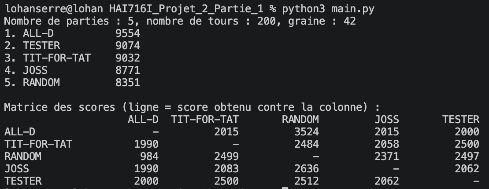

# Journal de bord : tournoi du dilemme du prisonnier itéré

## Vendredi 13/11/2026 : mise en place

**Langage :** Python

**Organisation :**
- `moteur.py` : gestion des parties, des tournois et des scores.
- `strategies.py` : implémentation des stratégies.
- `main.py` : lancement des tournois.

**Protocole :** 5 parties de 200 tours par rencontre, sans matchs contre soi-même. Graine fixée à 42 pour obtenir des résultats reproductibles.

## Étape 1 — Tournoi de base

### 1. Les stratégies

Les 5 stratégies du cours :

- **ALL-D** : joue toujours D.
- **RANDOM** : joue C ou D au hasard (50 % chacun).
- **TIT-FOR-TAT (TFT)** : commence par C, puis copie le dernier coup adverse.
- **JOSS** : fonctionne comme TFT, mais trahit parfois (10 % de chances lorsqu'elle devrait coopérer).
- **TESTER** : commence par D. Si l'adversaire riposte, passe en TFT. Sinon, répète C, C, D.

Pour TESTER, j'ai interprété "riposter" comme le fait que l'adversaire ait déjà joué D. La description du cours n'est pas totalement précise sur ce point.

### 2. Prédictions avant le tournoi

Avant de lancer le tournoi, je pensais obtenir ce classement :

1. ALL-D
2. JOSS
3. TIT-FOR-TAT
4. TESTER
5. RANDOM

**Pourquoi ?**

- **ALL-D** devrait bien s'en sortir en profitant des stratégies qui coopèrent.
- **JOSS** pourrait faire mieux que TFT puisqu'il fonctionne de la même manière, mais trahit parfois pour gagner davantage de points.
- **TFT** devrait obtenir de bons résultats grâce à sa coopération et à sa capacité à répondre aux trahisons.
- **TESTER** pourrait perdre des points en provoquant des représailles avec ses trahisons.
- **RANDOM** devrait finir dernier, car il joue au hasard sans s'adapter à son adversaire.

Je pense donc que TFT ne gagnera pas le tournoi, car ALL-D et JOSS pourraient obtenir davantage de points en profitant des stratégies coopératives.

### 3. Résultats du tournoi

**Classement obtenu :**

| Rang | Stratégie | Score |
|---|---|---:|
| 1 | ALL-D | 9554 |
| 2 | TESTER | 9074 |
| 3 | TIT-FOR-TAT | 9032 |
| 4 | JOSS | 8771 |
| 5 | RANDOM | 8351 |

Capture d'écran : 

### 4. Comparaison avec les prédictions

**Ce qui était juste :**
- ALL-D termine premier et RANDOM dernier, comme prévu.
- TFT termine bien troisième.

**Ce qui m'a surpris :**
- JOSS termine quatrième alors que je pensais qu'il serait deuxième. Ses trahisons occasionnelles ne lui rapportent finalement pas autant que prévu et peuvent provoquer des représailles.
- TESTER termine deuxième alors que je l'avais placé quatrième. Sa façon de tester ses adversaires semble donc plus efficace que ce que je pensais.

### 5. Pourquoi TFT ne gagne pas ?

TFT ne gagne pas le tournoi, contrairement au tournoi d'Axelrod présenté dans le cours.

Cela peut s'expliquer par plusieurs raisons :
- **La population est différente :** il y a moins de stratégies favorisant la coopération.
- **RANDOM avantage ALL-D :** ALL-D profite des coopérations aléatoires de RANDOM pour gagner beaucoup de points.
- **Les matchs contre soi-même sont exclus :** TFT ne bénéficie donc pas des points qu'il aurait obtenus en coopérant avec son double.

Cela montre que le résultat d'une stratégie dépend beaucoup des adversaires présents dans le tournoi.