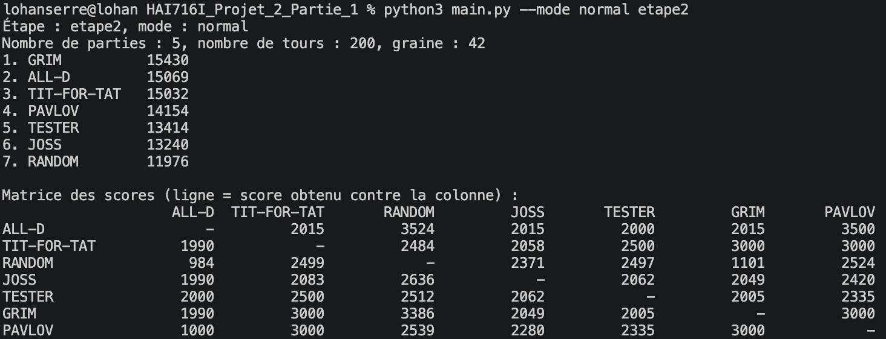
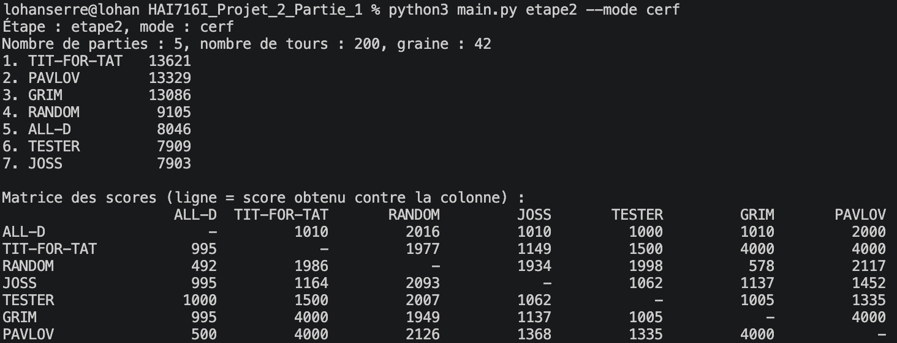
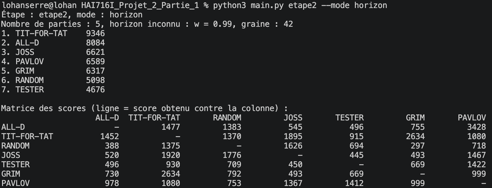

# Journal de bord : tournoi du dilemme du prisonnier itéré

## Vendredi 13/11/2026 : mise en place

**Langage :** Python

**Organisation :**
- `moteur.py` : gestion des parties, des tournois et des scores.
- `strategies.py` : implémentation des stratégies.
- `main.py` : lancement des tournois.

**Protocole :** 5 parties de 200 tours par rencontre, sans matchs contre soi-même. Graine fixée à 42 pour obtenir des résultats reproductibles.

## Étape 1 : Tournoi de base

### 1. Les stratégies

Les 5 stratégies du cours :

- **ALL-D** : joue toujours D.
- **RANDOM** : joue C ou D au hasard (50 % chacun).
- **TIT-FOR-TAT (TFT)** : commence par C, puis copie le dernier coup adverse.
- **JOSS** : fonctionne comme TFT, mais trahit parfois (10 % de chances lorsqu'elle devrait coopérer).
- **TESTER** : commence par D. Si l'adversaire riposte, passe en TFT. Sinon, répète C, C, D.

Pour TESTER, j'ai interprété "riposter" comme le fait que l'adversaire ait déjà joué D. La description du cours n'est pas totalement précise sur ce point.

### 2. Prédictions avant le tournoi

Avant de lancer le tournoi, je partirais sur ce classement :

1. ALL-D
2. JOSS
3. TIT-FOR-TAT
4. TESTER
5. RANDOM

**Pourquoi ?**

- **ALL-D** devrait bien s'en sortir en profitant des stratégies qui coopèrent.
- **JOSS** pourrait faire mieux que TFT puisqu'il fonctionne de la même manière, mais trahit parfois pour gagner davantage de points.
- **TFT** devrait obtenir de bons résultats grâce à sa coopération et à sa capacité à répondre aux trahisons.
- **TESTER** pourrait perdre des points en provoquant des représailles avec ses trahisons.
- **RANDOM** devrait finir dernier, car il joue au hasard sans s'adapter à son adversaire.

Je pense donc que TFT ne gagnera pas le tournoi, car ALL-D et JOSS pourraient obtenir davantage de points en profitant des stratégies coopératives.

### 3. Résultats du tournoi

**Classement obtenu :**

| Rang | Stratégie | Score |
|---|---|---:|
| 1 | ALL-D | 9554 |
| 2 | TESTER | 9074 |
| 3 | TIT-FOR-TAT | 9032 |
| 4 | JOSS | 8771 |
| 5 | RANDOM | 8351 |

Capture d'écran : 

### 4. Comparaison avec les prédictions

**Ce qui était juste :**
- ALL-D termine premier et RANDOM dernier, comme prévu.
- TFT termine bien troisième.

**Ce qui m'a surpris :**
- JOSS termine quatrième alors que je pensais qu'il serait deuxième. Ses trahisons occasionnelles ne lui rapportent finalement pas autant que prévu et peuvent provoquer des représailles.
- TESTER termine deuxième alors que je l'avais placé quatrième. Sa façon de tester ses adversaires semble donc plus efficace que ce que je pensais.

### 5. Pourquoi TFT ne gagne pas ?

TFT ne gagne pas le tournoi, contrairement au tournoi d'Axelrod présenté dans le cours.

Cela peut s'expliquer par plusieurs raisons :
- **La population est différente :** il y a moins de stratégies favorisant la coopération.
- **RANDOM avantage ALL-D :** ALL-D profite des coopérations aléatoires de RANDOM pour gagner beaucoup de points.
- **Les matchs contre soi-même sont exclus :** TFT ne bénéficie donc pas des points qu'il aurait obtenus en coopérant avec son double.

Cela montre que le résultat d'une stratégie dépend beaucoup des adversaires présents dans le tournoi.

### 6. Difficultés rencontrées

- **Matchs contre soi-même :** au début, le mini-tournoi donnait 78 / 78 / 66 au lieu de 48 / 48 / 46. J'ai exclu ces rencontres avec `range(i + 1, n)`.
- **Graines aléatoires :** ajouter une stratégie pouvait changer les tirages de certaines rencontres. Maintenant, les graines dépendent des indices des joueurs et du numéro de partie.

## Étape 2 : Ajout de deux stratégies

2 nouvelles stratégies :

- **GRIM** (Friedman, 1971) : commence par C, mais joue toujours D dès que l'adversaire a trahi une fois. Elle devrait bien fonctionner contre les stratégies coopératives, mais moins bien contre ALL-D.
- **PAVLOV** (Nowak et Sigmund, 1993) : commence par C. Si son dernier coup a été avantageux, elle le répète, sinon elle change de coup. Elle devrait bien fonctionner contre les stratégies coopératives, mais peut être exploitée par ALL-D.

**Protocole :** même tournoi qu'à l'étape 1 (5 parties de 200 tours, graine 42, sans matchs contre soi-même). GRIM et PAVLOV sont ajoutées dans la population.

**Résultats :**

| Rang | Stratégie | Score |
|---|---|---:|
| 1 | GRIM | 15430 |
| 2 | ALL-D | 15069 |
| 3 | TIT-FOR-TAT | 15032 |
| 4 | PAVLOV | 14154 |
| 5 | TESTER | 13414 |
| 6 | JOSS | 13240 |
| 7 | RANDOM | 11976 |

**Bilan :** GRIM prend la première place à ALL-D. Elle gagne beaucoup de points contre TFT et PAVLOV grâce à la coopération, ainsi que contre RANDOM. ALL-D reste deuxième, notamment parce qu'elle profite de RANDOM et des réactions de PAVLOV. TFT reste troisième. Les scores totaux augmentent parce qu'il y a plus d'adversaires.

## Étape 3 : Deux modifications du tournoi

Deux modifications du tournoi avec les sept stratégies de l'étape 2 : la chasse au cerf et l'horizon inconnu.

### 1. Chasse au cerf (autres gains)

**Modification :** la matrice devient (C,C) = (4,4), (C,D) = (0,3), (D,C) = (3,0) et (D,D) = (1,1). Les parties durent toujours 200 tours.

**Prédiction :** 
Je pense que ALL-D va descendre dans le classement, car la trahison rapporte moins qu'avant.

À l'inverse, TFT devrait monter, puisque la coopération est davantage récompensée.

Je pense aussi que GRIM, PAVLOV et les stratégies utilisant de l'aléatoire (JOSS et RANDOM) vont perdre des places, car leurs comportements pourraient être moins avantageux avec cette nouvelle matrice.

**Résultats :**

| Rang | Stratégie | Score |
|---|---|---:|
| 1 | TIT-FOR-TAT | 13621 |
| 2 | PAVLOV | 13329 |
| 3 | GRIM | 13086 |
| 4 | RANDOM | 9105 |
| 5 | ALL-D | 8046 |
| 6 | TESTER | 7909 |
| 7 | JOSS | 7903 |

*Capture d'écran après exécution de `python3 main.py etape2 --mode cerf`.*

**Comparaison avec la prédiction :** 

Mes prédictions sont en partie correctes :

- ALL-D descend de la 2e à la 5e place.
- TFT passe de la 3e à la 1re place.
- GRIM descend de la 1re à la 3e place.

En revanche, PAVLOV et RANDOM montent dans le classement, contrairement à ce que je pensais.

**Bilan :** Avec cette matrice, la coopération rapporte davantage et la trahison systématique est moins intéressante.

### 2. Horizon inconnu

**Modification :** à la fin de chaque tour, la partie continue avec une probabilité `w = 0.99`. Elle ne dure donc plus obligatoirement 200 tours et peut aussi les dépasser. J'ai choisi `w = 0.99` pour avoir des parties assez longues, mais dont la durée reste imprévisible (environ 100 tours).

**Prédiction :**
Je pense que cette modification ne changera pas beaucoup le classement.

Les stratégies qui trahissent devraient continuer à être avantagées et pourraient même creuser l'écart avec les autres.

Selon moi, le fait que les parties durent plus ou moins longtemps ne devrait pas changer énormément les résultats.

**Résultats :**

| Rang | Stratégie | Score |
|---|---|---:|
| 1 | TIT-FOR-TAT | 9346 |
| 2 | ALL-D | 8084 |
| 3 | JOSS | 6621 |
| 4 | PAVLOV | 6589 |
| 5 | GRIM | 6317 |
| 6 | RANDOM | 5098 |
| 7 | TESTER | 4676 |

*Capture d'écran après exécution de `python3 main.py etape2 --mode horizon`.*

**Comparaison avec la prédiction :**
Mes prédictions ne sont pas vraiment confirmées :

- TFT passe de la 3e à la 1re place.
- ALL-D reste 2e, mais ne prend pas la tête.
- GRIM descend de la 1re à la 5e place.
- JOSS remonte de la 6e à la 3e place.

Le classement change donc davantage. Les stratégies qui trahissent ne sont pas toutes avantagées, et TFT termine première.

**Bilan :** avec des durées différentes selon les rencontres, les scores cumulés ne sont pas directement comparables à ceux du tournoi à 200 tours fixes. Pour mieux juger les stratégies, il faudrait également regarder leurs points moyens par tour.

## Conclusion

Le classement dépend à la fois des stratégies présentes et des règles du jeu. GRIM gagne le tournoi élargi, TFT gagne avec les gains de la chasse au cerf et termine aussi première en points cumulés avec l'horizon inconnu. Les deux modifications montrent donc que changer les règles peut changer le vainqueur.
